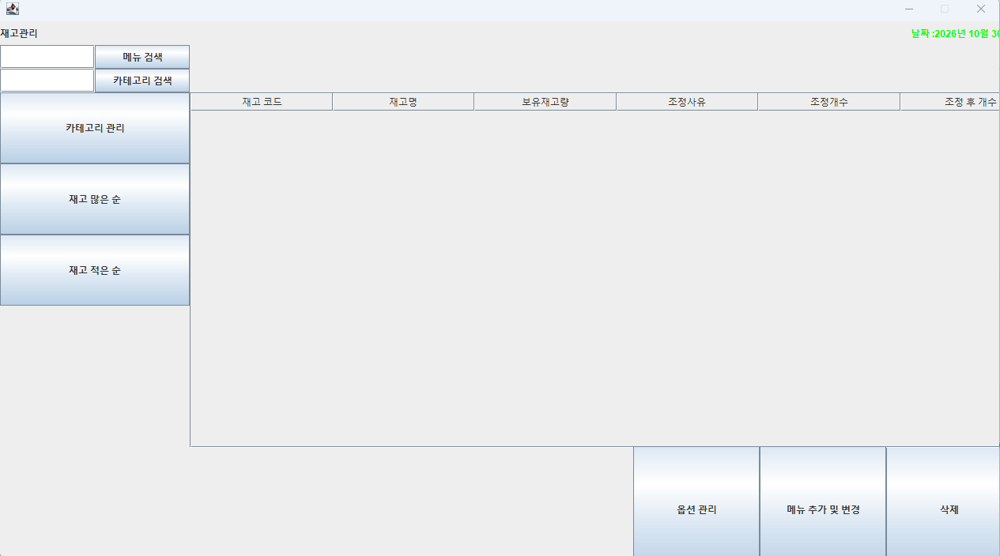

# InventoryManagement

Java Swing과 MySQL을 이용한 POS 시스템의 상품·재고관리 화면입니다.
기존 POS 팀 프로젝트에서 사용한 코드를 포트폴리오용으로 정리했습니다.

## 프로젝트 및 담당 역할

- 개발 형태: 팀 프로젝트
- 본인 담당: 상품관리 화면 및 상품 등록·수정·삭제·검색 기능 개발
- 매출관리 화면은 다른 팀원이 담당했습니다.

이 저장소에는 상품관리 기능이 포함된 Inventory.java를 정리했습니다.
아래 기능 목록은 포함된 코드의 기능을 설명하며, 모두를 개인 담당 범위로 의미하지는 않습니다.
로그인, 직원관리, 매출관리 및 POS 결제 화면은 포함하지 않습니다.

## 사용 기술

- Java, Swing, JDBC
- MySQL
- Eclipse IDE

원래 개발 당시의 도구 버전과 정확한 개발 기간은 확인 중입니다.

## 주요 기능

| 기능 | 구현 내용 |
| --- | --- |
| 상품(메뉴) 관리 | 상품 추가, 가격·재고량 변경, 삭제 |
| 검색 | 메뉴명·카테고리명 부분 검색 |
| 재고 조회 | stock 테이블 조회 결과를 JTable에 표시 |
| 재고 정렬 | 조정후개수 기준 오름차순·내림차순 정렬 |
| 카테고리 관리 | 카테고리 추가 및 해당 메뉴와 함께 삭제 |
| 옵션 관리 | 옵션 조회·추가·삭제 |
| 입력 검사 | 숫자 입력, 음수 재고, 중복 메뉴 등의 검사 |

## 실행 화면

## 현재 확인 상태

- 현재 PC의 Eclipse에서 Java Swing 화면 실행을 확인했습니다.
- 현재 PC에 MySQL이 설치되어 있지 않아 DB 연동 기능은 재검증하지 못했습니다.
- 위 기능 목록은 소스코드에 구현된 내용을 기준으로 작성했습니다.
- DB 연결이 없으면 데이터 조회·저장 기능은 사용할 수 없습니다.

## 실행 방법

1. Eclipse에서 File → New → Java Project로 프로젝트를 생성합니다.
2. module-info.java는 생성하지 않습니다.
3. 이 저장소의 src/Inventory.java를 프로젝트의 src 폴더에 복사합니다.
4. Inventory.java 우클릭 → Run As → Java Application으로 실행합니다.
5. DB 기능을 사용하려면 아래 설정을 진행합니다.

### DB 준비

MySQL 8.0 이상에서 `sql/inventory_sample.sql`을 실행합니다.

- 원래 posdb와 별개인 inventory_portfolio DB를 사용합니다.
- 원본 덤프에서 관련 테이블 4개의 구조를 추출했습니다.
- 데이터는 원본 데이터가 아닌 새로 작성한 샘플입니다.
- 직원 및 매출 테이블은 포함하지 않습니다.
- 새 DB에 한 번 실행하는 용도이며, 반복 실행하면 테이블 또는 기본키 중복 오류가 발생할 수 있습니다.

필요한 테이블과 컬럼은 [DB 안내](docs/database.md)를 참고하세요.

### MySQL 연결

MySQL Connector/J의 JAR 파일을 준비하고 다음 위치에서 추가합니다.

프로젝트 Properties → Java Build Path → Libraries → Classpath → Add External JARs

이후 Eclipse의 다음 위치에서 환경변수를 설정합니다.

Run → Run Configurations → Java Application → Inventory → Environment

| 변수 | 값 예시 |
| --- | --- |
| INVENTORY_DB_URL | jdbc:mysql://localhost:3306/inventory_portfolio?serverTimezone=UTC |
| INVENTORY_DB_USER | 자신의 DB 사용자명 |
| INVENTORY_DB_PASSWORD | 자신의 DB 비밀번호 |

실제 비밀번호는 소스나 README에 기록하지 않습니다.
현재 코드는 환경변수를 읽으며, .env 파일만 생성하는 것으로는 설정되지 않습니다.

## 현재 한계

상품 변경은 menu 테이블에, 메인 재고 목록 조회는 stock 테이블에 접근합니다.

현재 코드와 제공된 덤프에는 두 테이블을 자동으로 동기화하는 처리가 없어,
상품의 재고량 변경이 메인 재고 목록에 자동 반영되지 않습니다.

DB 복원 및 실제 데이터 조회·저장에 대한 통합 실행 검증은 추후 진행할 예정입니다.

## 포트폴리오 정리 과정

- DB 접속 계정·비밀번호를 소스에서 제거하고 환경변수로 분리했습니다.
- DB 연결 URL의 serverTimezone 표기를 정리했습니다.
- 공개용 샘플 SQL과 실행 안내를 추가했습니다.
- 그 외 기존 UI 및 SQL 처리 로직은 유지했습니다.

## 향후 개선 계획

- PreparedStatement를 이용한 SQL 처리
- try-with-resources를 이용한 DB 자원 정리
- 여러 DELETE 작업의 트랜잭션 처리
- DB 작업과 UI 코드 분리
- 입력 검증 개선

위 항목들은 향후 계획이며, 완료된 기능이 아닙니다.
